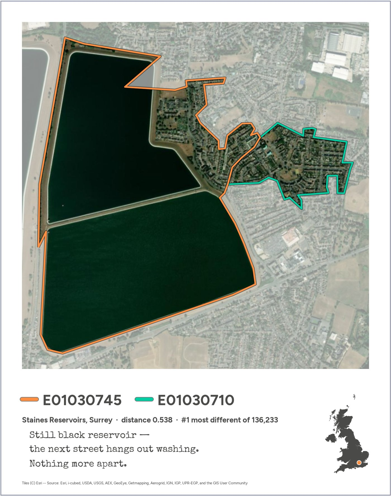

# Neighbours, near and far

**#30DayMapChallenge · Day 10 · Prompting only**

The UK's most different and most alike neighbouring small areas, seen through [AlphaEarth](https://deepmind.google/discover/blog/alphaearth-foundations-helps-map-our-planet-in-unprecedented-detail/) satellite embeddings, presented as three Polaroid cards. Everything here (the analysis, the maps, the haiku and the website) was made by prompting [Claude Code](https://claude.com/claude-code). The website tells the story and includes the full conversation.

**Website: <https://darribas.org/map_challenge26-prompt_only/>**



## What's in the repository

| Path | What it is |
|---|---|
| `index.qmd`, `backstory.qmd`, `prompts.qmd`, `transcript.qmd`, `notebooks.qmd`, `log.qmd` | The website's pages ([Quarto](https://quarto.org)) |
| `_quarto.yml`, `site/theme.scss` | Site configuration and the Polaroid theme |
| `docs/` | **The built website**, which GitHub Pages serves. Rebuilt by `quarto render` |
| `gdsl30dmc_submission.ipynb` | The submission, start to end: data → neighbours → distances → three pairs → cards |
| `gdsl30dmc.ipynb`, `gdsl30dmc_clusters.ipynb` | The exploration that led there |
| `gdsl30dmc_tools.py` | Shared code: data loading, contiguity, distances, the Polaroid card template |
| `LOG.md` | Exploration log written along the way |
| `SPEC.md` | The original brief |
| `conversation/` | The Claude Code conversation, exported (`conversation.json` + the images in it) |
| `scripts/` | Site helpers (see below) |
| `images/` | Web-sized copies of the figures, used by the site |
| `figures/submission/` | The three final cards at full resolution (200 dpi), and `social.png`, the three on one canvas for posting (`python scripts/make_social.py`) |
| `fonts/` | Fonts for the cards (see `fonts/README.md` for licences) |
| `data/` | **Not included.** See below |

## Publish the website on GitHub Pages

The site is already built in `docs/`, so publishing needs no tools:

1. Push this folder to a GitHub repository (e.g. `git init`, `git add .`, `git commit -m "Day 10"`, then push).
2. On GitHub, open the repository's **Settings → Pages**.
3. Under **Build and deployment**, set **Source** to *Deploy from a branch*, choose your branch (`main`) and the **`/docs`** folder, and **Save**.
4. After a minute or two the site is live at `https://<your-user>.github.io/<repository>/`.

`docs/.nojekyll` tells GitHub not to process the files with Jekyll; it's recreated on every render, so leave it there.

Optionally, put that address in `site-url` in `_quarto.yml` so Quarto can generate absolute links for sharing.

## Rebuild the website

You only need this if you change a page, the theme or a notebook. It does **not** need the data: notebooks are shown with the outputs saved in them, and nothing is executed.

Requirements: [Quarto](https://quarto.org/docs/get-started/) (≥ 1.5; built with 1.10) and Python 3 with Pillow (`pip install pillow`).

```bash
quarto render          # builds the whole site into docs/
quarto preview         # or: live preview while editing, at http://localhost:<port>
```

Rendering runs two small scripts automatically:

- `scripts/build_site.py` (before): makes web-sized JPEGs from `figures/` into `images/`, builds the transcript and prompt pages from `conversation/conversation.json` into `_generated/`, and writes the counts used in the text to `_variables.yml`. If `figures/` only holds the submission cards (as in a fresh clone), the existing copies in `images/` are kept.
- `scripts/post_render.py` (after): adds `docs/.nojekyll`.

Then commit `docs/` and push; GitHub Pages picks up the change.

### Refreshing the conversation

`conversation/` was exported from the Claude Code session file with:

```bash
python scripts/export_conversation.py ~/.claude/projects/<project>/<session-id>.jsonl
```

The export keeps the prompts, Claude's replies, its tool calls (truncated) and every image in the conversation; it leaves out Claude's internal reasoning and the instructions the harness injects, shortens machine-specific paths and redacts email addresses. The session file itself isn't in the repository. You only need this to re-export, for example after continuing the conversation.

## Re-run the analysis

This needs the data, which isn't in the repository.

1. **Get the data.** Download the 2024 file of Imago's [Google Satellite Embedding for small areas (2017–2024)](https://data.imago.ac.uk/datasets/google-satellite-embedding-v1-small-areas-2017-2024) and save it as:

   ```
   data/extracted-lsoa-geopackage_2024_output.gpkg
   ```

   One GeoPackage per year, with a polygon and 64 mean embedding bands (`band1_mean` … `band64_mean`) for every LSOA (England and Wales), Data Zone (Scotland) and Super Data Zone (Northern Ireland), indexed by `data_zone_code`. Only 2024 is used.

2. **Install the Python packages** (Python 3.12):

   ```bash
   python -m venv .venv && source .venv/bin/activate
   pip install -r requirements.txt
   ```

   Geopandas wheels bring their own GDAL/PROJ; if `pip` struggles on your platform, use conda/mamba (`conda install -c conda-forge geopandas libpysal contextily scikit-learn pyarrow jupyterlab`).

3. **Run the notebooks** from the repository root (they import `gdsl30dmc_tools.py` from there):

   - **`gdsl30dmc_submission.ipynb`** reproduces the three final cards into `figures/submission/` in about two minutes. Start here.
   - `gdsl30dmc.ipynb` then `gdsl30dmc_clusters.ipynb` reproduce the exploration (the clusters notebook takes several minutes, mostly fetching satellite tiles).

   The cards fetch Esri World Imagery tiles, so you need an internet connection. The notebooks write caches to `data/` (`uk_outline.parquet`, `pair_distances_2024.parquet`, …); delete them to recompute.

   The submission notebook checks that the picked pairs are the ones its captions were written for, and stops if they aren't, so a different data release can't put a poem on the wrong picture.

## Credits

- Embeddings: Google Satellite Embedding (AlphaEarth Foundations), aggregated to UK small areas by [Imago](https://imago.ac.uk).
- Imagery on the cards: Esri World Imagery (attribution printed on each card).
- Place names checked with [OpenStreetMap](https://www.openstreetmap.org/copyright) Nominatim.
- Fonts: Figtree, Special Elite, Courier Prime (see `fonts/README.md`).
- Made by prompting Claude Code; the full conversation is on the site.
