The submission is three cards, but it took  prompts over  days to get there. This is the route, chapter by chapter. Each chapter quotes the prompts that turned the corner: the typed notes are the human's words, unedited, and their numbers link to the exact spot in the [transcript](transcript.qmd). The images are what Claude looked at along the way, most of which never made it into a notebook.

## 1 · The brief

The project started from a short brief, `SPEC.md`: map the UK's most dissimilar neighbouring small areas, measuring similarity with AlphaEarth embeddings from [Imago](https://data.imago.ac.uk/datasets/google-satellite-embedding-v1-small-areas-2017-2024), using geopandas and PySAL's new `Graph`, and keeping a log of explorations.



## 2 · Who touches whom

Before comparing neighbours, we need to know who the neighbours are. Queen contiguity (areas sharing at least a corner) across all four nations gave a graph with one surprise: no links at all across the England–Scotland border, because the two nations' polygons overlap rather than touch. Fuzzy contiguity, which also counts overlaps, fixed that with 21 extra links. Twelve island areas had no neighbours at all and were dropped.




::: {.polaroid .tilt-l}
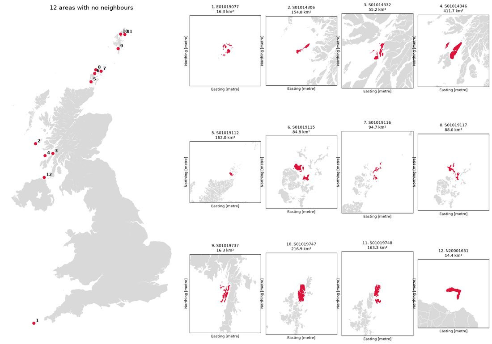
[The twelve areas with no neighbours, all of them Scottish islands.]{.caption}
:::

## 3 · Measuring difference

Each area's embedding is a 64-number vector; the difference between two neighbours is the cosine distance between their vectors, computed for all 136,233 neighbouring pairs. The human pushed for splitting the work into 16 chunks, one per core, which (after a detour about threads versus processes and memory layout) made it fast.




We also scored each area against its whole neighbourhood, in two ways: the average distance to each neighbour (`mean_dist`), and the distance to the average neighbour (`lag_dist`).



## 4 · Finding a look

The first maps were plain: satellite imagery with the area and its neighbours outlined. Then came a long stretch of iteration on the look, which became the Polaroid card used on every map since.

::: {.prints .wide .column-page}
::: {.polaroid}
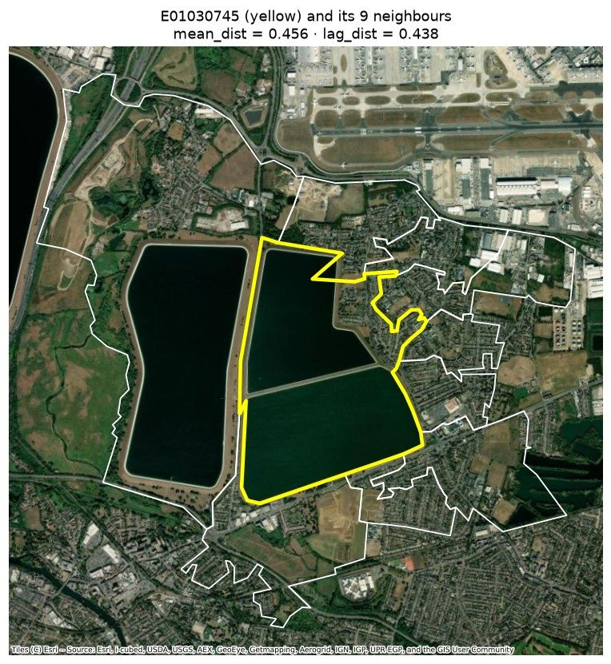
[First attempt: white and yellow outlines on raw imagery.]{.caption}
:::
::: {.polaroid}
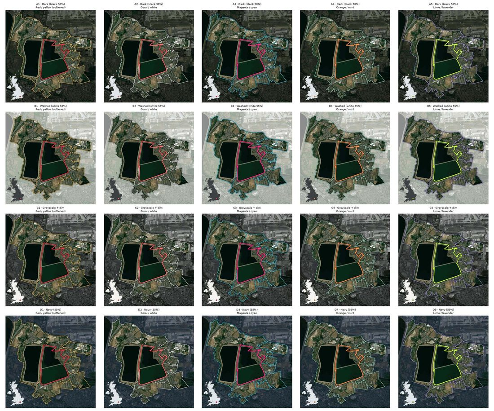
[Fifteen combinations of wash colour and outline colours, side by side.]{.caption}
:::
:::




The palette then moved to Imago's own: the human attached the brand palette, and the cards took on Imago grey, Figtree and a UK locator with an orange dot.





::: {.polaroid .tilt-r style="max-width:420px"}
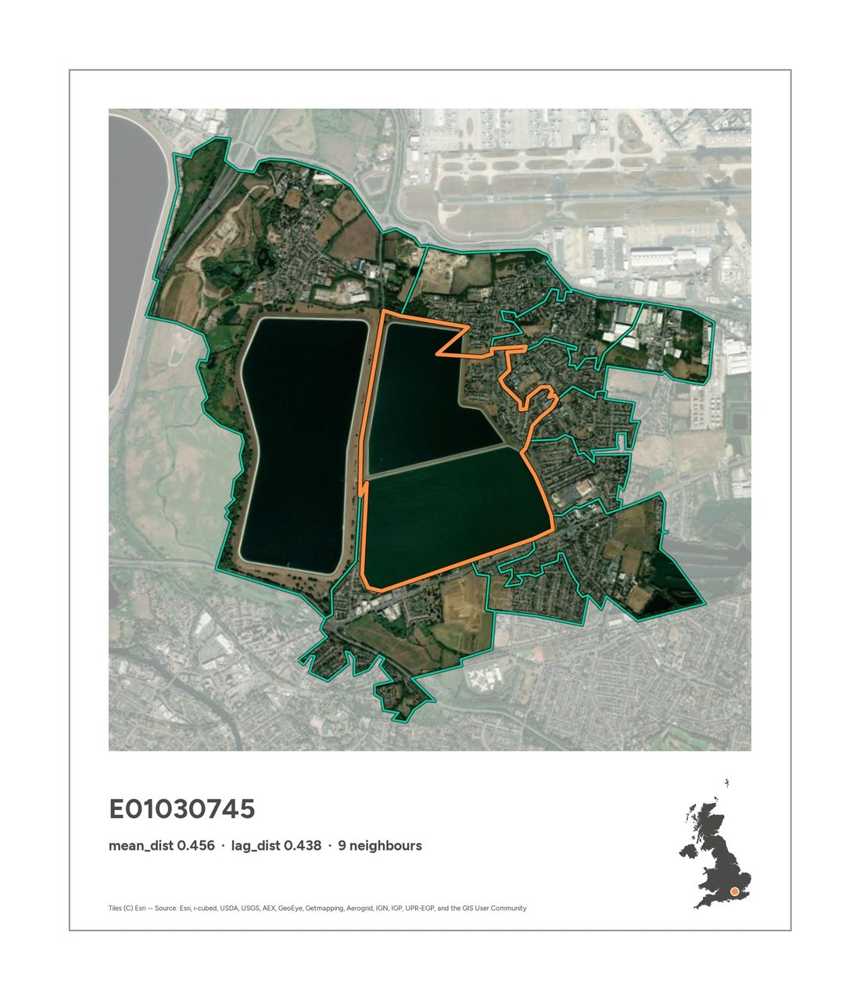
[The first true Polaroid: deeper bottom margin, thin outline so it holds up on a white page.]{.caption}
:::

## 5 · True, but not interesting

The most different area in the UK was the same by every measure: the Staines reservoirs, by Heathrow. The next ones were mostly small towns surrounded by fields. Switching from areas to pairs of areas didn't help much: the top pairs were nearly all built-up land against open land.

::: {.prints .column-page}
[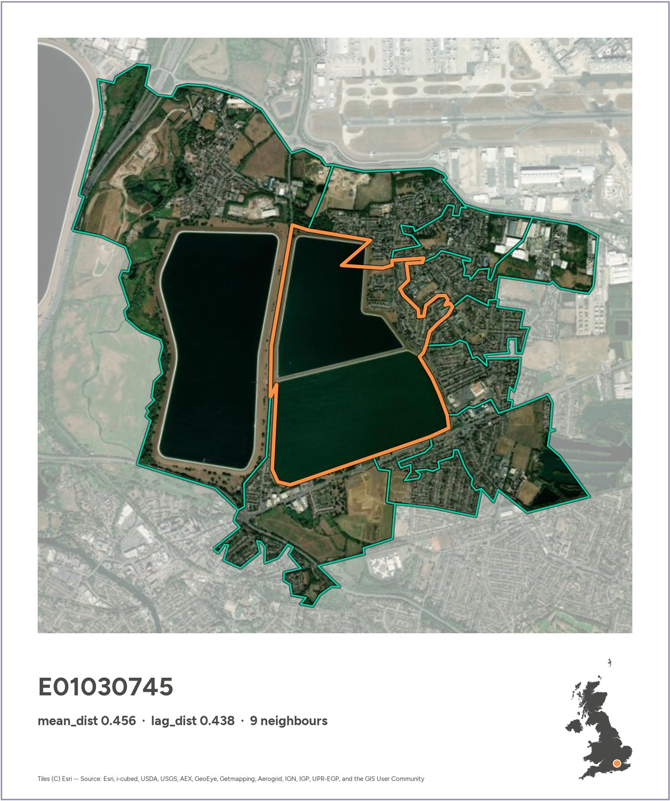{.print}](images/E01030745.jpg)

[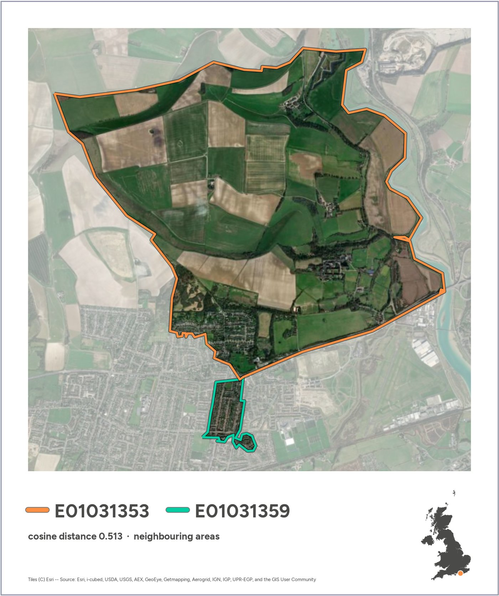{.print}](images/pair_E01031353_E01031359.jpg)

[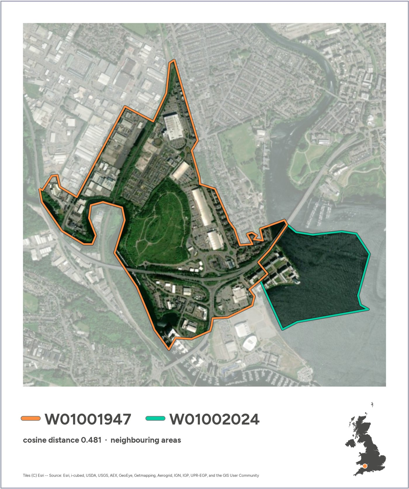{.print}](images/pair_W01001947_W01002024.jpg)
:::



## 6 · Clustering the embeddings

To find more interesting contrasts, the human proposed two ideas: restrict the search to cities, or cluster the areas into types and search between types. We went with clustering: k-means at two levels (20 broad types and 100 fine ones), interpreted by looking at contact sheets of each cluster's most typical areas.



::: {.prints .wide .column-page}
::: {.polaroid}
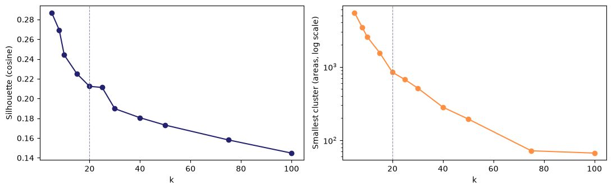
[Choosing k: no elbow anywhere. The embeddings form gradients, not clumps.]{.caption}
:::
::: {.polaroid}
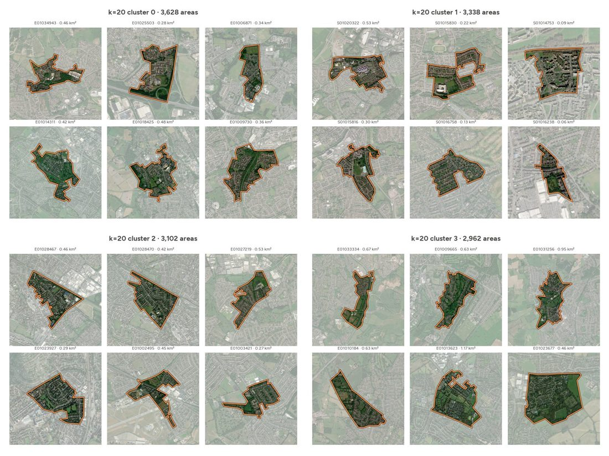
[Contact sheets of the 20 broad clusters, used to label them by eye.]{.caption}
:::
:::

The broad cluster that looked like "city centres" turned out to be dense mixed use; at the fine level, cluster 95 was the real thing: high-rise business cores, from the City of London to central Glasgow.




## 7 · Making distances legible

How big is a distance of 0.3? The cards gained a histogram of all 136,233 distances with the pair marked on it, and then a chart comparing the two embeddings band by band, which went through four designs.





::: {.polaroid .tilt-s}
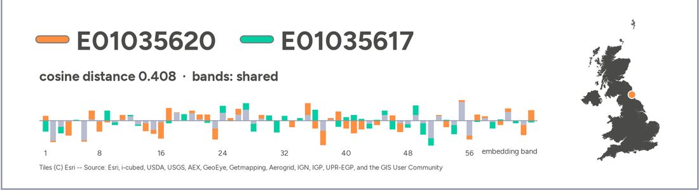
[The "shared" design: what the two areas have in common is grey, only the gap is coloured. The more grey, the more alike.]{.caption}
:::

Along the way the human kept asking the most useful question in the project: *why?* When two Glasgow pairs ranked as very different but looked the same, Claude checked: the embeddings separated offices from tenements that look alike from above, but the areas were tiny and on the edge of their clusters.



## 8 · Distinct places

Scanning all 100 fine clusters turned up a handful of clearly delimited kinds of place: reservoirs, industrial estates, golf courses, woodland, harbours, coastal fringe. For each, we made the top three pairs. Two stood out: the Staines reservoirs again, and a strip of fenland on the Nene Washes that looks like fields in the photo but sits with the reservoirs in the embeddings, most likely because it floods in winter.




::: {.prints .wide .column-page}
::: {.polaroid}
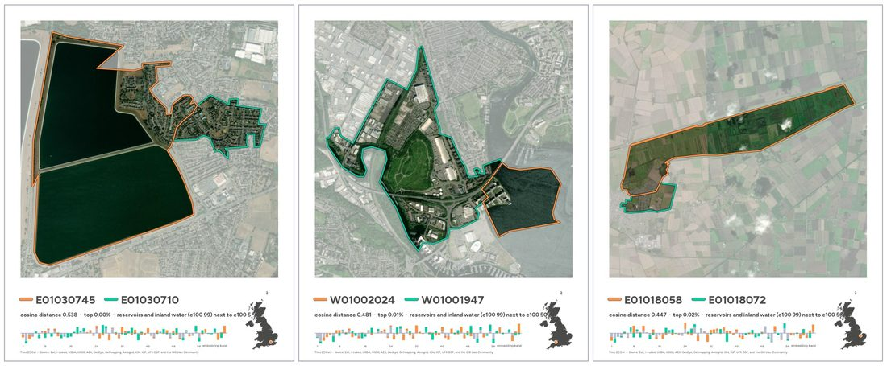
[Reservoirs: Staines, Cardiff Bay and the Nene Washes.]{.caption}
:::
::: {.polaroid}
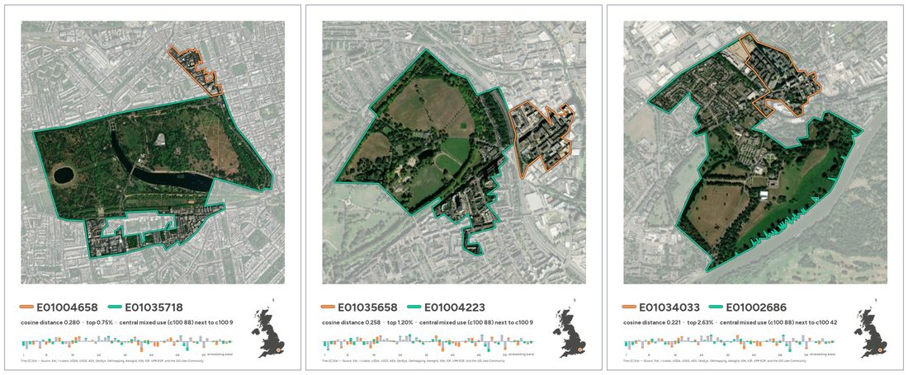
[Central London blocks next to the royal parks.]{.caption}
:::
:::

## 9 · Choosing, and a puzzle

Asked to pick a few cards for the submission, Claude proposed Staines, the Nene Washes and a retail park against the Peak District moors. The human wanted one entirely inside a settlement. The best candidate was two areas of west London terraced housing, ranked in the top 0.3% most different, which looked identical. The human called it out.




::: {.polaroid .tilt-l}
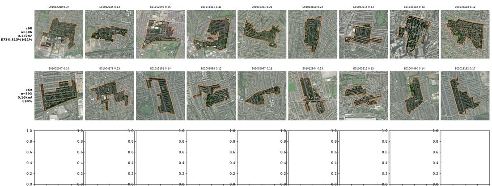
[Typical areas from the two clusters involved. Both look like dense terraces; the model keeps them 0.3 apart.]{.caption}
:::

Both areas turned out to be typical members of two clusters that the model keeps far apart, though they look alike. The untested hypothesis is street orientation: the two grids run at right angles, and radar, one of AlphaEarth's inputs, is sensitive to that. It was too uncertain to use as a showcase, so Hackney Marshes took its place, for a while.

## 10 · Fewer numbers, more words

The final turn was about tone. The histogram and band charts were too technical for the post, so they made way for a haiku in a typewriter face. And the human flipped the idea: keep the most different pair, and set it against the most similar ones.





::: {.polaroid .tilt-r}
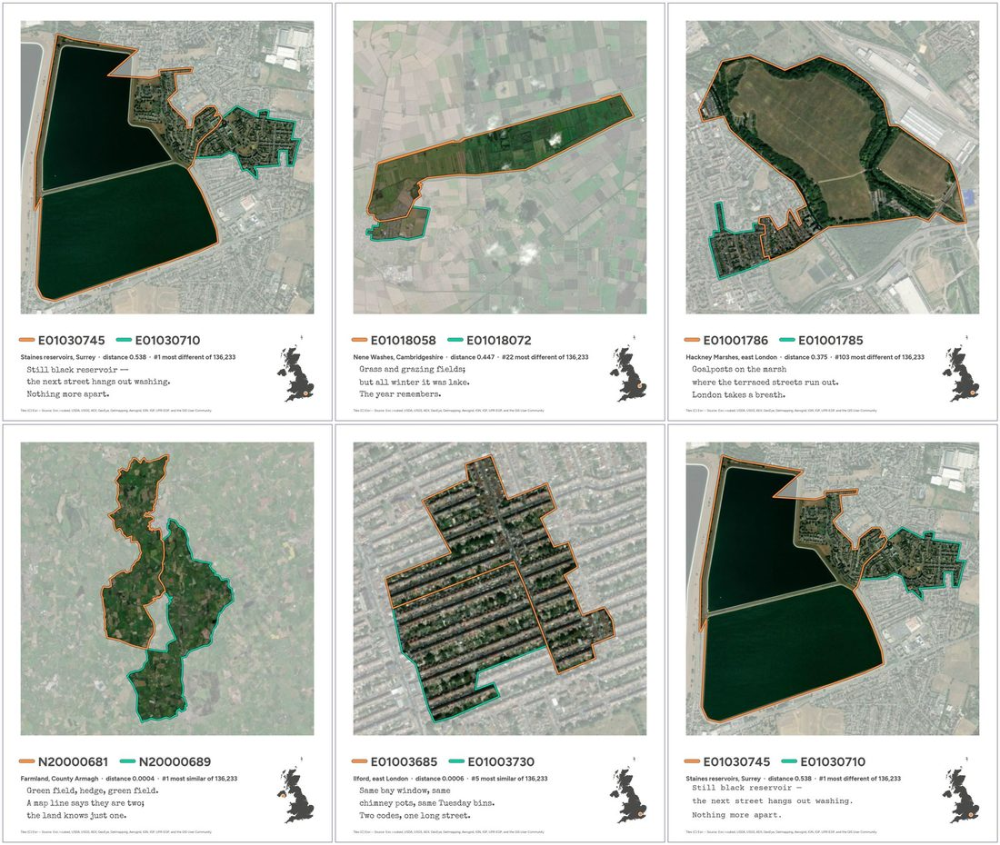
[First haiku drafts, including two cards that didn't make it (Nene Washes, Hackney Marshes) and Courier Prime for comparison.]{.caption}
:::

The final pipeline is a short standalone notebook ([3 · The submission](gdsl30dmc_submission.ipynb)) that goes from raw data to the three cards by rule, with the place names checked against OpenStreetMap, because on a prompting-only day the human doesn't check them by hand.



## 11 · This site

The last prompt asked for this website, with the conversation threaded through it.


