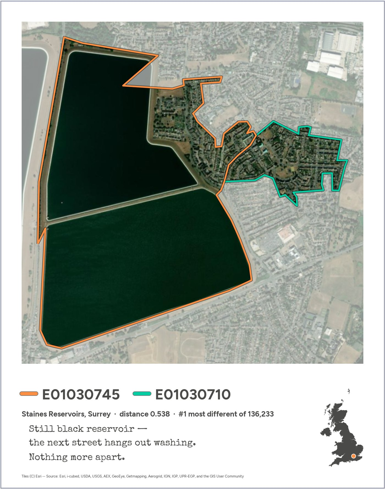
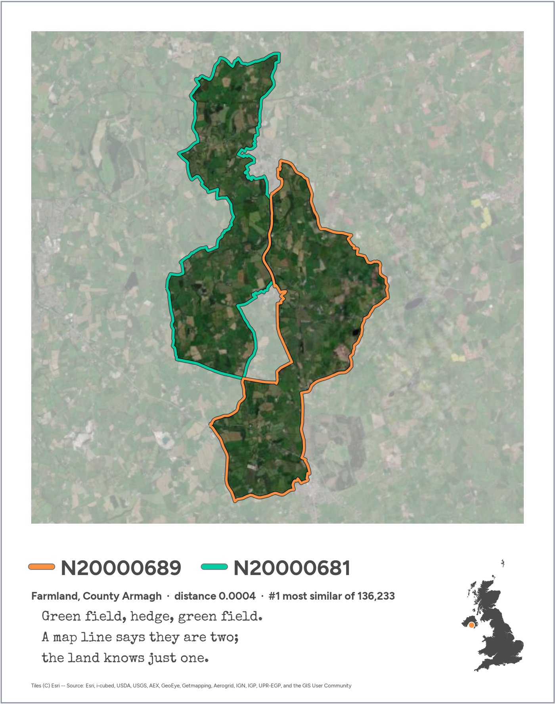
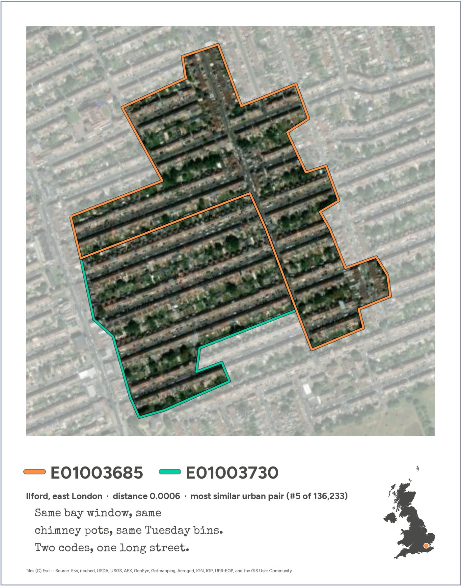

Every small area in the UK, all 46,832 of them, has a 2024 [AlphaEarth](https://deepmind.google/discover/blog/alphaearth-foundations-helps-map-our-planet-in-unprecedented-detail/) embedding, made available by [Imago](https://data.imago.ac.uk/datasets/google-satellite-embedding-v1-small-areas-2017-2024): 64 numbers that sum up a year of satellite observations of the place. Compare each area with the ones it touches and you get 136,233 pairs of neighbours, which we can rank from most different to most alike.

These are three of them.

::: {.prints .column-page}
[{.print fig-alt="Staines Reservoirs next to the streets of Stanwell, Surrey: the most different neighbouring pair in the UK."}](images/submission/1_most_different.jpg)

[{.print fig-alt="Two stretches of farmland in County Armagh: the most similar neighbouring pair in the UK."}](images/submission/2_most_similar.jpg)

[{.print fig-alt="Two halves of the same terraced streets in Ilford, east London: the most similar urban neighbours."}](images/submission/3_most_similar_urban.jpg)
:::

**The most different:** Staines Reservoirs and the streets of Stanwell next door, #1 of 136,233 pairs. 
**The most alike:** two stretches of farmland in County Armagh. 
**The most alike in a city:** two halves of the same terraced streets in Ilford.

The first is the one you'd guess. The other two are more interesting: the boundaries we use to count people often split places that, as far as the satellites can tell, are the same place.

## Reading a card

Each card is a Polaroid of one pair of neighbouring areas. The two areas are outlined in orange and green over Esri satellite imagery, and everything else is washed out. Underneath are the areas' official codes, the place, the cosine distance between their embeddings (0 means identical; the largest in the UK is 0.538) and its rank among all pairs. The UK locator shows where the pair is. The haiku says what the numbers can't.

## The post

The text that went out with the cards:

::: {.post}
#30DayMapChallenge, day 10: prompting only.

Every small area in the UK (46,832 of them) has a 2024 AlphaEarth embedding, made available through Imago: 64 numbers that sum up a year of satellite observations. Compare each area with the ones it touches and you get 136,233 pairs of neighbours, ranked from most different to most alike.

Three of them:

1. The most different: Staines Reservoirs and the streets of Stanwell next door.
2. The most alike: two stretches of farmland in County Armagh.
3. The most alike in a city: two halves of the same terraced streets in Ilford.

The first is the one you'd guess. The other two are more interesting: the boundaries we use to count people often split places that, as far as the satellites can tell, are the same place.

Everything here (the data processing, the maps, even the haiku) came from prompting Claude Code. No code written by hand.

#30DayMapChallenge #GeographicDataScience
:::

## How it was made

Day 10's rule was *prompting only*: "make AI work for its money and produce something from start to finish in a chat window or on the command line". Everything on this site was made in one conversation with [Claude Code](https://claude.com/claude-code), from reading the data to the haiku and this website.

::: {.stats}
[<b></b>prompts]{.stat}
[<b></b>words typed]{.stat}
[<b></b>tool calls by Claude]{.stat}
[<b></b>images Claude looked at]{.stat}
[<b></b>days of work]{.stat}
:::

It started with this:



and went through a lot of ideas that didn't make the cut. To dig in:

- **[Backstory](backstory.qmd):** the route from the brief to these three cards, chapter by chapter, with the dead ends and the prompts that turned each corner.
- **[The prompts](prompts.qmd):** every message the human typed, in order. On a prompting-only day, that's the source code.
- **[Transcript](transcript.qmd):** the whole conversation, including Claude's replies, every tool call and every image it looked at.
- **[Notebooks](notebooks.qmd):** the analysis as it was run, ending with a short notebook that builds the submission from start to end.
- **[Log](log.qmd):** the exploration log kept along the way.
